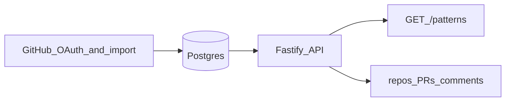

# PR-Patterns product roadmap

**Audience:** you (and maybe a few friends) on your own GitHub data.  
**First ship:** a dashboard you open weekly and act on.  
**Second ship:** something that intervenes in the PR workflow.  
**Not in scope yet:** multi-tenant SaaS billing, org-wide admin, marketplace GitHub App for strangers.

## Where you are (v0.2.0)

Built: OAuth login + public-repo import, SQL for users/repos/PRs/comments, unauthenticated read APIs including `GET /patterns`, word-key grouping in `apps/api/src/services/patternService.ts`.

Missing for a real product: session-gated data, UI, patterns that match rewritten feedback, deploy you can open from a browser, and anything that talks back into a PR.

## Phase map

| Phase | Outcome you can feel |
| --- | --- |
| 4 | Only you can see your data; login session is real |
| 5 | Your actual review comments form real pattern groups |
| 6 | React app: sign in, see patterns, drill into examples |
| 7 | Each pattern has a short “do this next time” tip |
| 8 | Bot/check comments on a new PR when a pattern is about to repeat |

Keep shipping through `feature/*` → `develop` → `release/vX` → `main`; bump the changelog on each release.

---

## How we build: TDD

From Phase 4 forward, new behavior is test-driven. The repo today has almost no automated tests (`npm test` is a stub); that changes with the first Phase 4 commit.

**Loop for every change:**

1. Write a failing test that names the behavior (red).
2. Write the smallest code that makes it pass (green).
3. Refactor with tests still green.

**Layers:**

- **Unit** — pure logic first (`patternKey`, `groupComments`, tip templates, auth helpers). Fast, no Postgres. Land a real test runner in `apps/api` (e.g. Node’s built-in test runner or Vitest) and replace the placeholder `npm test` script.
- **HTTP** — route contracts with a test Fastify instance or the existing verify-pr-patterns-api skill for proof against a running server. Prefer in-process route tests for auth/401/200; keep the skill for end-to-end smoke.
- **UI (Phase 6+)** — component tests for pattern list/detail rendering; one smoke path for “logged-in home shows patterns.”

**Rules:**

- No feature PR merges without tests that would have failed before the change.
- Bugs get a regression test before the fix.
- Refactors are proven by existing tests so behavior cannot silently shrink.
- Behavior changes on `develop` require tests (see CONTRIBUTING).

---

## Phase 4 — Personal trust boundary

**Done when:** after GitHub login, every read/write for repos, PRs, comments, and patterns requires your session and only returns rows owned by that user.

- Persist a server session (cookie) after OAuth callback in `apps/api/src/controllers/authController.ts`; stop trusting bare `userId` / `author` / `repositoryId` from the client for authorization.
- Scope repository and pattern queries by `users.id` (join through `repositories.user_id`). `GET /patterns?author=` becomes “patterns for the signed-in user’s login” or an explicit owned scope—not arbitrary author strings.
- Bind the API to loopback or put it behind the same-origin web app; leave `0.0.0.0` only for deliberate remote use.
- **TDD:** failing tests first for logged-out `401` on `/patterns`, `/repositories`, `/pull-requests`, `/review-comments`; then tests that a session only sees owned rows. Implement session + scoping until green. Smoke path (sign in → import → patterns → logged out → 401) is the final proof.

## Phase 5 — Patterns that work on real comments

**Done when:** `GET /patterns` for your account returns groups you recognize (e.g. the pool-error-listener theme across PRs), not only near-identical short phrases.

- Keep the URL and response shape (`label`, `count`, `examples`); change only how `patternKey` / grouping decides sameness.
- Prefer a small, local improvement first (stronger stemming/normalization or token overlap threshold) over calling an external LLM; document the rule so counts stay stable.
- **TDD:** add failing fixtures first—the five-comment “Add a test” case (count 3), plus at least two real rewritten-paragraph pairs from your import that should share a group. Implement the new sameness rule until those pass; re-run against imported data as confirmation, not as the only test.

## Phase 6 — Weekly dashboard (React)

**Done when:** you open a local (or hosted) URL, sign in with GitHub, and see your top patterns with examples—no curl.

- Add `apps/web` (React + TypeScript) as planned in the README; monorepo root already has `apps/` and empty `packages/`.
- Screens: login → home list of patterns (sorted by count) → pattern detail with examples and links back to GitHub if you store or can derive URLs later.
- Call the existing API with session cookies (`credentials: 'include'`); no duplicate business logic in the client.
- One composition, brand-forward first viewport (product name hero); avoid dashboard clutter on the landing view—patterns list is the product after login.
- Dev story: API on one port, web on another with proxy or CORS locked to that origin.
- **TDD:** failing component tests for “pattern list renders label, count, examples” and “empty list state”; then build the UI. Mock the API in unit tests; one manual or skill-backed smoke for real login.

## Phase 7 — “What to do next”

**Done when:** each pattern card shows a one-line next action derived from the group (not just the raw label).

- Add a `tip` (or `nextAction`) field on the pattern response, generated deterministically from the label/examples (template rules first).
- UI shows tip next to count; optional “mark as working on this” later—not required for phase exit.
- Still no multi-user coaching product; tips are for the signed-in developer only.
- **TDD:** failing unit tests for tip strings from known labels/examples before implementing the template function; UI test asserts the tip appears on the card.

## Phase 8 — Workflow intervention

**Done when:** opening or updating a PR you author can surface “you’ve been told X on N prior PRs” in GitHub.

- GitHub App or Actions-friendly check that loads your stored patterns for the PR author and posts a comment or check annotation when the PR touches themes you’ve seen before (start with comment-only on repos you install).
- Reuse import + pattern pipeline; do not re-implement grouping in the bot.
- Gate on your user/install only; public install for the world stays out of this phase.
- Success metric: on a new PR, you see at least one accurate reminder tied to a Phase 5+ pattern.
- **TDD:** failing tests for “given patterns + a synthetic PR payload → comment body includes pattern label and count”; implement the matcher/poster until green. Live GitHub install is the final smoke only.

---

## Cross-cutting (every phase)

- TDD as above; `npm test` in `apps/api` (and later `apps/web`) must be a real suite, run before merge.
- Keep the verify-api skill for HTTP proof against a running server where in-process tests are not enough.
- `CHANGELOG.md` updated on each `release/v*`.
- Deploy target for Phase 6+: single-user host is enough (e.g. one VPS or PaaS box with Postgres + API + web). No multi-region story.
- README status moves from “Early Development” to “Personal beta” once Phase 6 ships.

## Suggested near-term order of work

Start Phase 4 on `develop` next (session + ownership). Without it, a React UI would still be an open read API on your imported data. Phase 5 can overlap once auth scopes patterns to you. Phase 6 is the first “product you open.” Phases 7–8 build on that habit.
